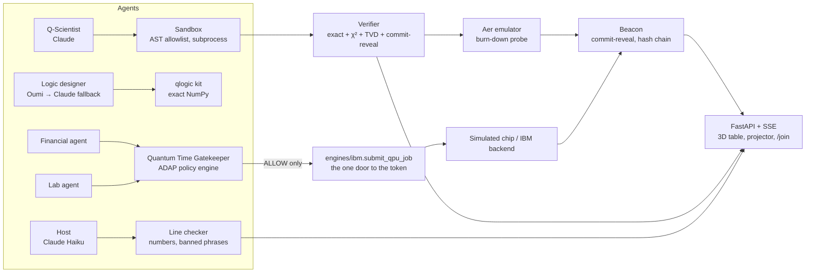

# PITCH.md — Quantum Table (3 minutes, English)

**Disclosure sentence (say it once):** The dice, the verifier, the emulator runs, the beacon and the policy gate are real; the chip in this demo is a simulated fake backend, the art and the voice are AI-generated, and the Logic designer ran on a Claude fallback because the Oumi project had no deployed model.

## Script with timings

| Time | Say | Show |
|---|---|---|
| 0:00 | "Quantum Table. AI agents design a craps game; the dice are qubits; and nobody at the table, not a player, not the house, not an agent, controls a roll alone." | The 3D table |
| 0:15 | "Tap Roll. First the circuit runs and a verifier checks it. Only then the dice land, on the faces that were measured." | Roll → VERIFIED badge |
| 0:30 | "Join, and your dice are entangled with the house pair. The six arrows above your dice shrink to the centre: each qubit alone has no state of its own. After the roll they snap to the poles that spell your face. These arrows are computed from the real statevector, not drawn to look nice." | Join → thread → Roll |
| 0:55 | "Every player adds six qubits. Exact simulation needs 16 bytes times 2 to the n. On this machine the emulator ran 29 qubits and was refused at 30. Skip ahead: the emulator burns down and the chip takes over." | Skip ahead → meter |
| 1:15 | "On the chip you buy a coupled pair with Qredits, priced from its calibration error. All pairs go in one job. Results come back per pair with error bars, compared by distance, never with a chi-square against the ideal. Today the chip is a simulated fake backend, and the screen says so." | Chip map → Run chip job |
| 1:40 | "Real quantum time costs money, so no agent may submit on its own. The Quantum Time Gatekeeper, powered by ADAP's policy engine, allows up to 10 seconds, asks a person up to 60, blocks beyond. Try to overspend: BLOCK. Try to charge a player: BLOCK. There is no payment code in this build." | Overspend → Charge |
| 2:05 | "Between rolls the AI host deals a claim: 'entangled dice let you message the house instantly.' Bet Fact or Hype. The experiment runs: the house's distribution moves by 4 times 10 to the minus 16. Verdict: Hype. The verifier decides, not the host." | Hype or Fact |
| 2:30 | "And every roll is a public record: each participant commits a secret, the quantum counts are published, the selection is a fixed rule. Run verify_beacon.py: PASS. Collectively generated, publicly checkable. Not certified, not for money or elections; the real thing is NIST's CURBy. This is its playful cousin." | /beacon/latest → PASS |
| 2:50 | **Closing beat:** "This project was made the way the game works: a person's ideas, agents doing the building, and checks deciding what stayed. The AI wrote the circuits; the verifier passed them. The AI host wrote the commentary; a checker read every line. Thank you." | MAKING_OF link |

## Architecture

## Business model (simulation only)

The Quantum Time Gatekeeper is the meter; what could be sold is verified quantum computing time to whoever hosts a table. In this session the Financial agent priced 5 chip jobs: 0 QPU seconds used (fake backend), 11.35 estimated, list-price equivalent "price unavailable" because IBM's pricing page could not be fetched from the build machine and no price is ever typed from memory; shadow invoices only, marked "simulation, not a bill". Pricing is illustrative; selling this for real needs legal and tax advice and IBM's terms checked for resale. Qredits are never sold.

## The ten hardest jury questions

1. **Is any of this actually quantum?** The circuits are real Qiskit circuits and their statistics are exact quantum-theory predictions, but in this demo they ran on a classical statevector emulator. The chip path is wired and gated; today it points at a fake backend and says so.
2. **Then where does the randomness come from on the emulator?** From the participants' secrets, combined with the seeded emulator counts by a published rule. The quantum part is simulated; we say that on the record.
3. **Is the beacon certified?** No. It is "collectively generated and publicly checkable": nobody can steer it if at least one participant keeps their secret, and anyone can recompute it. The operator and the chip provider are still trusted for the quantum part. CURBy does the certified version with a loophole-free Bell test.
4. **Can a late revealer bias the result?** No, but they can force a re-run: a participant who does not reveal in 20 s is dropped and the round re-runs without them, and the record says so.
5. **Why should I trust the AI's circuit?** You shouldn't; the verifier does the trusting: the exact distribution from the statevector must equal the agent's stated distribution to 1e-9, shots must pass χ² at p > 0.01, and the code+expectation hash is committed before the run.
6. **What exactly is entangled, and can it signal?** Each player's six qubits are CNOT-copied from the house pair, so outcomes are perfectly correlated; the house's own marginal does not change whatever the player does (we measure 4e-16 on the Hype card). No signal.
7. **Why do the Bloch arrows shrink?** The reduced density matrix of an entangled qubit is mixed; its Bloch vector is shorter than 1. For a Bell pair it is exactly 0 (unit-tested). Top bits of a die keep length 1/3 because faces 5–6 vs 1–4 are not balanced.
8. **Is 30 qubits really the classical limit?** No: it is the limit of exact statevector simulation at 16 bytes per amplitude on a 16.9 GB machine. Other classical methods go further; we say that on screen. ~50 qubits is where no machine stores the full vector.
9. **What does ADAP do here, and what doesn't it?** ADAP's open-source policy engine evaluates every tool call of the Lab and Financial agents in-process (ALLOW / REQUIRE_HUMAN / BLOCK with a rule id). It is not ADAP's signed-delegation path and issues no receipts. It works because the IBM token sits behind one function that calls the gate first.
10. **Is this gambling?** No. Qredits have no cash value and cannot be bought, sold or withdrawn; no payment code exists; the Financial agent's `charge_customer` is blocked by policy. The business idea sells verified compute time to a host, never the dice.

## Closing beat (20 s)

This project was itself made the way the game works: a person supplied the leaps (a game, a table, a chip, a crowd, a beacon), agents did the building, and checks, not opinions, decided what stayed. See `MAKING_OF.md`.
