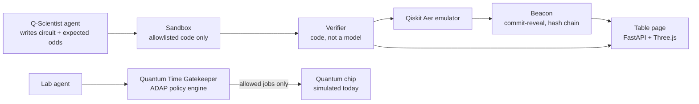

# Quantum Table

**Dice no one controls alone, and anyone can check.** A team of AI agents runs a quantum craps table. Your dice are entangled with the house's dice, a verifier written in code (not a model) checks every roll, and every roll is published as a record anyone can recompute.

- **Live demo:** https://warm-dawn.boxd.sh
- **Demo video (1 min):** _YouTube link to be added_
- Built solo at the Gen AI Summit agents hackathon, Spata, 14–15 Nov 2026, by Ioannis Theodonis (NTUA quantum computers & technologies lab) with a team of AI agents.

## Who it's for

- **Students and the curious** meeting quantum computing for the first time: they play first and learn about qubits, entanglement and why quantum chips matter along the way.
- **Builders of games and AI agents** that need a fair random draw they can prove they didn't rig.
- **Anyone who decides by chance** (a game, a lottery, a tie-break, an agent's choice) and wants a record others can check.

## The problem

Every random draw is a black box. You trust the house, the server, or now the AI, and you can't see how the draw was made. Meanwhile real quantum hardware feels out of reach for most people.

## What it does

1. **Join** the table: pick a nickname and get 100 Qredits (play credits with no cash value).
2. **Your dice are entangled** with the house's dice. In this game (Bosonic dice, from the original Qraps) your faces always match the house's, and nobody chooses the number.
3. **Roll.** The agents' quantum circuit runs 1024 shots on the Qiskit Aer emulator. The verifier checks it against the exact quantum prediction, and only then do the dice land on the measured faces.
4. **See the physics:** the Dice tomography card shows measured frequencies against the exact prediction. The arrows above your dice are each qubit's Bloch vector, and they shrink when entangled.
5. **Check it yourself:** every roll is a public beacon record. `python3 verify_beacon.py https://warm-dawn.boxd.sh` prints PASS or FAIL.

## How it works



- **Verifier** (`verifier/`): the agent's stated distribution must equal the exact statevector distribution to 1e-9, and the shots must pass a χ² test (p > 0.01). The code and the expectation are hashed before the run.
- **Beacon** (`beacon/`): every participant commits to a secret before the round and reveals it after. The secrets and the measured counts pick the outcome by a fixed public rule, and each record links to the previous one.
- **Burn-down:** every qubit doubles the memory exact simulation needs (16 bytes × 2ⁿ). On our server Aer ran 29 qubits and was refused at 30, which is the point where a table should move to a real chip.
- **Quantum Time Gatekeeper** (`gatekeeper/`, `adap/`): no agent can spend paid quantum-chip time alone. Each job is ALLOWed (≤ 10 s), sent to a human (≤ 60 s) or BLOCKed. Only one function can read the IBM token, and it asks the gate first.

## The AI team

| Agent | Job | Runs on (fallback) |
|---|---|---|
| Q-Scientist | writes the circuits and states the expected distribution | Claude (scripted circuits) |
| Logic designer | rules, payouts, exact odds, quantum-logic propositions | **Oumi** (project 7HBTQDVH6J-14, deployment 2); Claude is the fallback, labelled when used |
| Art director | table and chip graphics | fal.ai flux (built-in SVG) |
| Lab agent | picks where a roll runs; asks the Gatekeeper first | code + IBM runtime (fake backend) |
| Financial agent | quotes and shadow invoices; never charges anyone | code + Claude summary (template) |
| Table builder | 3D table, animates verified outcomes | Three.js (2D table) |
| Host | live commentary and claim cards, every line checked by code | Claude Haiku (templates) |
| Verifier | exact and statistical checks; its badge is final | code, never an LLM |

The page names the engine and model actually used for every result.

## What is real and what is simulated

| Real | Simulated or not yet done |
|---|---|
| Qiskit circuits, exact odds, verifier, sandbox, beacon and `verify_beacon.py`, tested | Rolls run on the Aer **emulator**, not on quantum hardware |
| Burn-down measured on our server (29 qubits ran, 30 refused) | The chip path uses IBM's **fake backend** (`FakeBrisbane`), labelled "Simulated chip": 0 real QPU seconds spent |
| Gatekeeper decisions by ADAP's open-source policy engine | ADAP policy engine only: no signed delegation receipts |
| Claude-written circuits pass the sandbox and the verifier; Oumi writes the quantum-logic propositions | The Oumi model's own probability predictions were classical-dice fractions; the kit evaluates the propositions on the real state and the page shows "Logic designer corrected" |

We say "collectively generated, publicly checkable". We never say "certified random", "proves" or "quantum advantage". On the emulator, the unpredictability comes from the participants' secrets. Qredits cannot be bought, sold or cashed out, and no payment code exists.

## Run it

```bash
git clone https://github.com/ioannis75/quantum-table && cd quantum-table
./run.sh                     # creates .venv, installs, serves on 0.0.0.0:8080
```

Then open `http://localhost:8080/`. Built and tested on Python 3.13. Node 22 + pnpm are optional (they build ADAP's policy engine, otherwise built-in rules are used).

**Keys are all optional.** Put them in `.env` (git-ignored): `ANTHROPIC_API_KEY`, `FAL_KEY`, `OUMI_API_KEY` + `OUMI_PROJECT_ID` + `OUMI_DEPLOYMENT_ID` + `OUMI_MODEL` + `OUMI_BASE_URL`, `IBM_QUANTUM_TOKEN`, `PUBLIC_URL`. Without keys everything still runs in scripted mode, and the page says which fallback is in use.

**Tests:** `. .venv/bin/activate && python -m pytest -q tests`

| Page | What it is |
|---|---|
| `/` | the table (3D; `?view=2d` for 2D) with Dice tomography and burn-down. "Extended: future plan" holds the chip buy-in, Gatekeeper, Hype or Fact, quantum vote and AI host (all working). |
| `/join` | seat a player from a phone (the QR on the page points here) |
| `/table` | projector view |
| `/chip` | alternative game: each die as 3 physical qubits through the fake backend's noise model |
| `/beacon/latest`, `/beacon/{round}` | public roll records |
| `/making-of` | how the agent team built this |
- Agree round: two players plus the house share a three-qutrit singlet; inconsistent reports are detected (illustration, emulator only). On `/lab`, under *Extended: future plan*.

## Next

- Run real rolls on an IBM quantum chip, through the Gatekeeper.
- Three-party agreement (two players plus the house in one entangled state) and key exchange feeding the beacon: `docs/IDEAS_byzantine_qkd.md`.
- Trainable circuits (small quantum neural networks) that the agents tune, with gradients checked by the verifier.

## Repo map

`agents/` the AI team · `verifier/` the checks · `games/qraps/` dice circuits and odds · `beacon/` public records · `gatekeeper/`, `adap/` spending policy · `engines/` Aer, IBM, burn-down · `static/` the page · `tests/` · `video/` demo video sources · `docs/` screenshots and notes

More detail: [`docs/TECHNICAL.md`](docs/TECHNICAL.md) (full technical notes), [`MAKING_OF.md`](MAKING_OF.md) (how it was built), [`HACKATHON.md`](HACKATHON.md) (build log), [`PITCH.md`](PITCH.md).

## Credits

- **Qraps**, the original quantum craps game (Quantum Game Jam 2021): https://github.com/SuperStingray/qraps. Our circuits reconstruct its dice modes.
- **ADAP**, Agent Delegated Authority Protocol (Apache-2.0): https://github.com/Hardalion/agent-delegated-authority
- Qiskit and Qiskit Aer, qiskit-ibm-runtime, FastAPI, Three.js (MIT), fal.ai, Claude.
- CURBy (NIST / CU Boulder), the certified randomness beacon this project is a playful cousin of.
