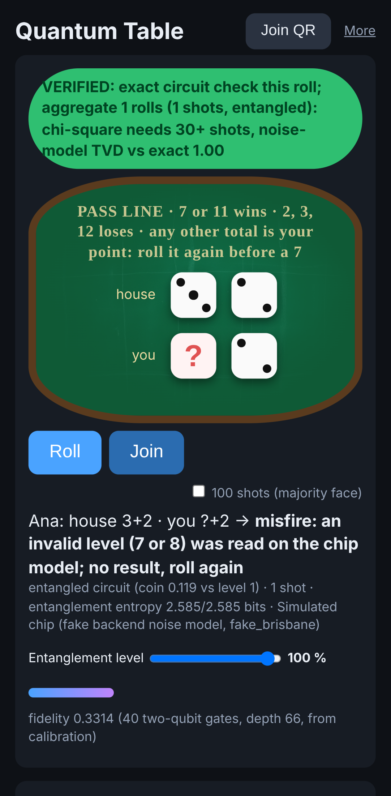
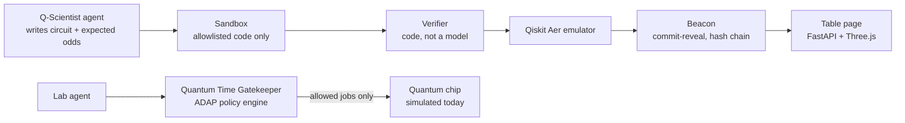

<div align="center">

# 🎲 Quantum Table

**Dice no one controls alone, and anyone can check.**

AI agents run a quantum craps table. Your dice are entangled with the house's dice, a verifier written in code (not a model) checks every roll, and every roll becomes a public record anyone can recompute.

[](https://warm-dawn.boxd.sh)
[](https://youtu.be/-U82UrLSq64)

<a href="https://youtu.be/-U82UrLSq64"></a>
&nbsp;


<sub>Video file in the repo: [`video/quantum-table-60s.mp4`](video/quantum-table-60s.mp4)</sub>

*Built solo at the Gen AI Summit agents hackathon, Spata, 14–15 Nov 2026, by **Ioannis Theodonis** (NTUA, quantum computers & technologies lab) and a team of eight AI agents.*

</div>

---

## Who it's for, and why

- **Students and the curious** meeting quantum computing for the first time. They play first, and they pick up qubits, entanglement and why quantum chips matter along the way.
- **Builders of games and AI agents** who need a random draw they can show they didn't rig.
- **Anyone who decides by chance**, whether it's a game, a lottery, a tie-break or an agent's choice, and wants a record others can check.

**The problem:** every random draw is a black box. You have to trust the house, the server, and now the AI. Meanwhile real quantum hardware feels out of reach for most people.

## Play in 30 seconds

1. **Join** with a nickname and get 100 Qredits. These are play credits with no cash value.
2. **Roll.** Your dice are entangled with the house's dice, so your faces always match and nobody chooses the number.
3. **Watch the check.** The circuit runs 1024 shots on the Qiskit Aer emulator. The verifier compares the result with the exact quantum prediction, and only then do the dice land.
4. **Verify it yourself.** Run `python3 verify_beacon.py https://warm-dawn.boxd.sh`. It prints PASS or FAIL.

## How it works



| | |
|---|---|
| **Verifier** | The agent's stated distribution must equal the exact statevector to 1e-9, and the shots must pass a χ² test. The code and the expectation are hashed before the run. |
| **Beacon** | Every participant commits to a secret before the round and reveals it after. A fixed public rule picks the outcome, and each record links to the previous one. |
| **Burn-down** | Each qubit doubles the memory that exact simulation needs. Our server ran 29 qubits and refused at 30. That's where a table should move to a real chip. |
| **Gatekeeper** | No agent can spend paid quantum-chip time alone. A job of up to 10 s is allowed, up to 60 s goes to a human, and anything more is blocked. |
| **Agree round** | Two players and the house share a three-qutrit singlet, and the verifier catches a party that reports a value inconsistent with the others. It's an illustration and runs on the emulator only. |

## Built by one person and eight agents

I came to the hackathon alone, so the agents were my team.

**Saturday: finding the idea.** I went through five ideas in twelve hours: a quantum roulette on our lab's NMR quantum computer, an "ask the quantum computer" lab, a post-quantum security adviser (deployed, then dropped) and a quantum-experiment copilot. Each one taught me something, and none of them was a game people would want to play.

**Saturday night: the idea clicks.** Around 02:30 I remembered my old game **Qraps** from the 2021 Quantum Game Jam. The plan grew from there: entangle the players' dice with the house, let the crowd burn down the emulator, put a gate in front of paid chip time and use plain words instead of hype. By 03:45 it fitted in one prompt. I pasted my API keys and went to sleep.

**03:54–05:10: the agents built it unattended.** They worked in Claude Code on my boxd machine. They built the verifier first, then the circuits, the page, the 3D table, the beacon and the Gatekeeper. They measured the burn-down instead of estimating it. They committed after every step and kept the tests green.

**Sunday: I steered, they rebuilt.** I looked at the table on my phone and asked for a simpler page that puts gameplay first. Then the Oumi model came online, and in the afternoon we added the three-party agreement round.

**The rule that made solo work:** I decided *what* to build, the agents built it, and **code decided what stayed**. These checks caught the agents more than once:
- the line checker caught a banned phrase in the Host's own template
- a test against ADAP's engine caught a too-lenient Gatekeeper rule
- the kit corrects the Oumi model's odds on screen whenever they're wrong

The full record is in [`MAKING_OF.md`](MAKING_OF.md).

| Agent | Job | Runs on (fallback) |
|---|---|---|
| Q-Scientist | writes the circuits and expected distributions | Claude (scripted circuits) |
| Logic designer | rules, payouts, quantum-logic propositions | small model on **Oumi** (Claude) |
| Art director | table art and voice | fal.ai (built-in SVG) |
| Lab agent | picks where a roll runs, asks the Gatekeeper first | code + IBM runtime, fake backend |
| Financial agent | quotes and shadow invoices; can never charge | code + Claude summary |
| Table builder | 3D table that animates verified outcomes | Three.js (2D table) |
| Host | live commentary; every line is checked by code | Claude Haiku (templates) |
| Verifier | the final word on every roll | **code, never an LLM** |

## What is real and what is simulated

| ✅ Real | 🧪 Simulated or not yet done |
|---|---|
| Qiskit circuits, exact odds, verifier, sandbox and beacon, all tested | Rolls run on the Aer **emulator**, not on quantum hardware |
| Burn-down measured on our server | The chip path uses IBM's **fake backend**: 0 real QPU seconds spent |
| Gatekeeper decisions by ADAP's open-source policy engine | No signed delegation receipts yet |
| Claude writes circuits and Oumi writes logic, and both are checked by code | Art and voice are AI-generated |

We say "collectively generated, publicly checkable". We never say "certified random", "proves" or "quantum advantage". Qredits can't be bought, sold or cashed out, and the code has no payment functions.

## Run it

```bash
git clone https://github.com/ioannis75/quantum-table && cd quantum-table
./run.sh          # creates .venv, installs, serves on :8080
```

All keys are optional. Without them everything still runs in scripted mode, and the page says which fallback is in use. The key names are listed in [`docs/TECHNICAL.md`](docs/TECHNICAL.md). To run the tests: `python -m pytest -q tests`.

| Page | What it is |
|---|---|
| `/` | the table (3D, or `?view=2d`). *Extended: future plan* holds the chip buy-in, Gatekeeper, Hype or Fact, quantum vote, AI host and Agree round. |
| `/join` | join from a phone (the QR code on the page points here) |
| `/table` | projector view |
| `/chip` | an alternative game where each die is 3 physical qubits on the chip's noise model |
| `/beacon/latest` | the public roll records |
| `/making-of` | how the agent team built this |

## Next

- Real rolls on an IBM quantum chip, through the Gatekeeper.
- Key exchange (BB84/E91) feeding the beacon: [`docs/IDEAS_byzantine_qkd.md`](docs/IDEAS_byzantine_qkd.md).
- The same table on our lab's real NMR qubits, for students.

## Credits

[Qraps](https://github.com/SuperStingray/qraps) (Quantum Game Jam 2021), whose dice modes we rebuilt as circuits · [ADAP](https://github.com/Hardalion/agent-delegated-authority) (Apache-2.0) · Qiskit, Qiskit Aer, qiskit-ibm-runtime · FastAPI · Three.js · fal.ai · Oumi · Claude · and CURBy (NIST / CU Boulder), the certified randomness beacon that this project is a playful cousin of.

More: [`docs/TECHNICAL.md`](docs/TECHNICAL.md) · [`HACKATHON.md`](HACKATHON.md) (build log) · [`PITCH.md`](PITCH.md)
